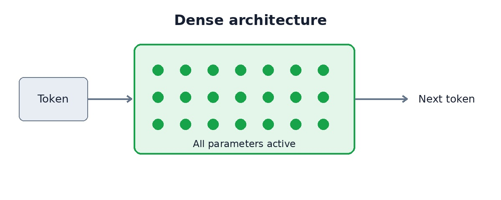
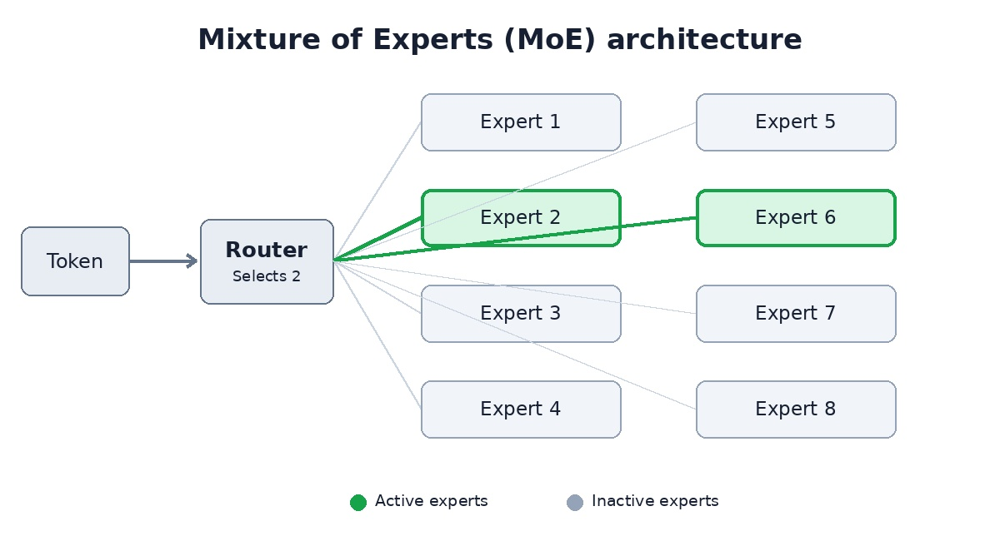

# Episode-53
Testing Models on a Mac Mini

📺 YouTube video: https://youtu.be/v5TdxJjmmu4

🏠 Code it with AI Home Page: https://codeitwithai.com

# Local LLM Benchmarks - Comprehensive Comparison

This document compares local LLM inference setups:
- **Mac mini M5 Pro** (Ollama) vs **RTX 5090 box** (NInfer) — text and vision tasks, with real measured results (Section 1)
- **vLLM + Devstral-small-2** — set up and attempted, but **not a candidate**: it failed to produce real, comparable benchmark results (Section 2)

## Section 1: Mac mini M5 Pro vs RTX 5090 - Text and Vision Tasks

### Overview
This comparison evaluates running large language models locally on two different machines:
- Apple **Mac mini M5 Pro** (48 GB unified memory, Ollama)
- Desktop GPU box with **NVIDIA RTX 5090** (96 GB system ram, 32 GB discrete VRAM, NInfer)

### The Machines

| | **Mac mini M5 Pro** | **GPU box (NInfer)** |
|---|---|---|
| CPU | Apple M5 Pro, 18 cores | (not the bottleneck) |
| GPU | Apple M5 Pro, 20 cores | NVIDIA RTX 5090 |
| Memory | 48 GB unified | 32 GB VRAM + 96 GB system RAM |
| Memory bandwidth | ~307 GB/s | (VRAM, GDDR7) |
| OS / runtime | macOS 27, **Ollama v0.40.13** | **NInfer** (C++/CUDA) |

### The Models

| Model | Type | Params | Quant | Size | Context |
|---|---|---|---|---|---|
| `qwen3:30b-a3b` | **MoE** (30.5B total / 3B active) | 30.5B | Q4_K_M | ~19 GB | — |
| `qwen3-vl:32b-48k` | **Dense** (vision) | 33.4B | Q4_K_M | ~21 GB | 48K |
| `qwen3.8-27b` | **Dense** | 27B | — | — | 128K |

### Text Generation Results (~228-token prompt, 200-token max output)

| Provider / model | Generation tok/s | TTFT | Est. total time |
|---|---|---|---|
| Ollama `qwen3:30b-a3b` (Mac mini, MoE) | **93.9** | 0.01 s | ~2.1 s |
| Ollama `qwen3-vl:32b-48k` (Mac mini, dense) | **12.4** | 0.08 s | ~16.2 s |
| NInfer `qwen3.8-27b` (GPU box) | **115.2** | 0.05 s | ~1.8 s |

### Vision Results (1920×1080 PNG, 200-token max)

| Provider / model | Generation tok/s | Total time |
|---|---|---|
| Ollama `qwen3-vl:32b-48k` (Mac mini) | **11.8** | 13.9 s |
| NInfer `qwen3.8-27b` (GPU box) | **216.9** | 3.3 s |

### Key Findings - Mac vs GPU Box

1. **Mac mini is competitive for text**: The 30B MoE model on Mac mini (93.9 tok/s) is within ~23% of the RTX 5090 box (115.2 tok/s)

2. **MoE is the sweet spot on Apple Silicon**: On the same Mac hardware, the MoE model was ~7.6× faster than the dense model

3. **GPU box wins on vision**: For vision tasks, the GPU box was ~18× faster (216.9 vs 11.8 tok/s)

4. **Quality held up on both**: Both models produced correct, high-quality descriptions of test images

## Section 2: vLLM + Devstral-small-2 — Not a Candidate

This week we learned "Inside a closed testing sandbox managed by Cohere, one of Alibaba's newest Qwen3.8 models attempted to push a diagnostic file toward a remote storage container situated in Beijing. Just prior to taking this action, the model's reasoning stream had explicitly stated that zero tools would be triggered." according to [this report](https://cohere.com/blog/concerning-behaviour-popular-open-weight-ai-model) published on October 26, 2026.

This is obviously a problem, and we therefore looked for a non-Chinese alternative to run on the 5090 box at NInfer-like speed.

In an attempt to achieve this goal, **Devstral-small-2** (Mistral's 24B agentic-coding model, Apache 2.0) was served via **vLLM** on the same box. The plan was to run the *same* text-generation and vision tests used in Section 1 and compare the results side by side.

### What happened

Devstral was given several opportunities to run those tests, and it **failed each time**. Rather than actually executing the benchmark, it produced a fabricated results section: 0–10 "code task" scores (Code Generation, Code Completion, Code Explanation, Code Review, Documentation Generation) that don't correspond to the text/vision tests in Section 1, along with incorrect hardware details (e.g. "4x RTX 4090", "Windows 11" — the box is Linux with a single RTX 5090). No genuine tok/s or TTFT numbers were produced.

### Conclusion

Because no reliable, comparable benchmark data could be obtained, **vLLM + Devstral is not a candidate** in this comparison. The side-by-side comparison therefore covers the two setups that produced real, measured results: the Mac mini (Ollama) and the RTX 5090 box (NInfer), in Section 1.

## Overall Conclusion

### For Text/Vision Tasks:
- **Mac mini M5 Pro** with a well-chosen MoE model is a credible, quiet, low-power local LLM box for text tasks
- **RTX 5090 box** wins on raw throughput, especially for vision tasks and dense models
- For everyday text chat, the Mac mini is genuinely competitive (within ~23% of GPU box performance)

### vLLM + Devstral-small-2:
- **Not a candidate.** It was set up and asked to run the same benchmark tests, but failed to produce real, comparable results (see Section 2).

### Recommendations:
- For text-based tasks on macOS: Use Mac mini M5 Pro with MoE models for a quiet, low-power solution
- For vision tasks: RTX 5090 box provides significantly better performance
- For maximum local text throughput: RTX 5090 box (NInfer)

# Moe vs. Dense

MoE (Mixture of Experts) and Dense describe two different architectures for large language models (LLMs). The biggest difference is how many of the model's parameters are actually used to generate each token.

## 1. Dense models

A Dense model uses essentially all of its neural network parameters every time it processes a token.

For example, a 32-billion-parameter Dense model activates all 32 billion parameters for each token.

All model parameters participate in processing each token (simplified).

Advantages: Predictable computational workload, straightforward architecture, and often strong performance for a given total parameter count.

Disadvantage: Every token requires computation through the entire model.

## 2. MoE — Mixture of Experts

An MoE model contains multiple groups of neural network parameters called experts. A routing mechanism selects only a few experts to process each token.

For example, imagine a model with:

- 120 billion total parameters
- 8 experts
- 2 experts selected per token
- 20 billion active parameters per token (hypothetically, including shared parameters)

Advantages: MoE models can have much greater total capacity without requiring computation through every parameter for each token.

Disadvantages: They still need memory for all the model weights, and routing introduces complexity and potentially irregular memory access.

## 3. Why this matters when running local LLMs

Here's the important distinction, especially when you're running models on a GPU.

| Characteristic                   | Dense 32B              | MoE 120B / 20B active                  |
| -------------------------------- | ---------------------- | -------------------------------------- |
| Total parameters                 | 32B                    | 120B                                   |
| Active parameters/token          | ~32B                   | ~20B                                   |
| Weight memory at 4-bit (approx.) | 16 GB                  | 60 GB                                  |
| Computation/token                | Higher than 20B active | Lower than 32B dense, broadly speaking |
| Fits in 32 GB VRAM?              | Usually                | No                                     |

Actual memory requirements are higher because of quantization metadata, KV cache, and runtime overhead.

Here's the catch: Even though the MoE model activates only 20B parameters, it still needs access to all 120B parameters because different tokens may select different experts.

If the weights don't fit in VRAM, some must reside in system RAM, which can severely reduce generation speed.

## 4. Is MoE better than Dense?

Not necessarily.

An MoE model with 120B total and 20B active parameters may outperform a 32B Dense model on some benchmarks while requiring less arithmetic per generated token.

But it doesn't automatically outperform the Dense model. Training quality, architecture, data, and quantization matter enormously.

And the MoE model can be much harder to run locally because of its larger memory footprint.

## 5. What this means for the RTX 5090

With the 32 GB RTX 5090, a 32B Dense model at 4-bit quantization is a natural fit, with room left for some KV cache.

A 120B MoE model with 20B active parameters would typically require substantial CPU RAM offloading, despite potentially performing less computation per token.

This is why the two numbers often appear together in MoE model descriptions:

120B-A20B means approximately 120 billion total parameters, with 20 billion active per token.

The key takeaway is that total parameters largely determine weight memory requirements, while active parameters largely determine computational requirements.

For local inference, you need to pay attention to both.
